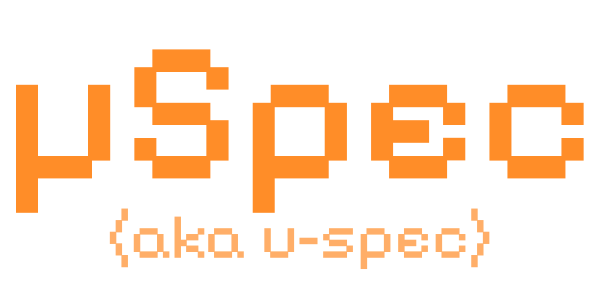

<p align="center">
  
</p>

# u-spec

Four skills for lightweight spec-driven development, inspired by
[OpenSpec](https://github.com/Fission-AI/OpenSpec/), with no CLI or dependencies.
One change = one Markdown file containing goal, requirements, approach, tasks and checks.

## Installation

This repository distributes skills; it is not a project's working `u-spec`
directory. Copy the four folders inside `skills/` into a skill directory supported
by your harness, such as `.agents/skills/`, `.github/skills/` for GitHub Copilot or
`.claude/skills/` for Claude Code. Keep the folder names unchanged. No other files
from this repository are required at runtime.

There is no installation directory recognized by every harness: skill discovery
depends on the bot, not the underlying model. Keep `skills/<name>/SKILL.md` as the
distribution format in this repository; prefer `.agents/skills/<name>/SKILL.md`
in consuming projects when supported, otherwise use the harness-specific path.
For harnesses without native skill discovery, explicitly ask the bot to read and
follow the selected `SKILL.md`. Each skill is self-contained and needs no CLI.
Installed skills and the project's `u-spec/` workflow artifacts remain separate.

The bot needs file access, the ability to ask questions and to run project checks.
Invocation syntax depends on the harness; skill names are `propose`, `change`,
`apply`, `archive`.

## Workflow

| Skill | Outcome |
| --- | --- |
| [propose](skills/propose/SKILL.md) | Reads applicable specs, investigates locally, asks until material doubts are resolved and prepares one file. No implementation. |
| [change](skills/change/SKILL.md) | Revises that file, including during implementation; requires fresh approval. No code changes. |
| [apply](skills/apply/SKILL.md) | Implements approved tasks, runs checks and records progress and evidence in the same file. |
| [archive](skills/archive/SKILL.md) | Consolidates current requirements into specs and preserves the complete change in archive. No implementation. |

Example: `propose add product search`, answer questions, approve,
`apply product-search`, optionally `change product-search`, then
`archive product-search`. An explicit `apply` request approves the current
document if no questions remain unresolved.

### Example: A Login Component

Request: "Use propose to create a Login component."

1. The bot reads project instructions, scans current spec titles and scopes, then
  reads every global spec and every `area:login` spec, plus the matching baseline
  if one exists. It inspects only nearby code and checks needed for the request.
2. It asks about unresolved responsibilities, states, validation, interactions,
  accessibility and exclusions. It investigates facts available in code rather
  than asking you to repeat them. Questions continue until material doubts are
  resolved; no component is implemented yet.
3. It writes one English document at `u-spec/changes/login-component.md` with
  `Scope: area:login`, goal, full requirements, approach, tasks and verification
  checks. If the capability already has a spec, it reuses that ID instead.
4. It requests approval. Use `change login-component` to revise the proposal;
  revisions require fresh approval. Unresolved questions keep it in `draft`.
5. Request `apply login-component` to implement the approved component in the
  project's normal directories. The bot runs checks and records task progress
  and concise evidence in the same change file. Scope revisions during this
  work go through `change`; failed or unavailable checks prevent completion.
6. Request `archive login-component` once the work is complete and verified. The
  bot consolidates current behavior into `u-spec/specs/login-component.md`, saves
  the full change in `u-spec/archive/<date>-login-component.md`, then removes the
  active change only after verifying both saved files. Archival is not automatic.

## Project Layout

```text
<project-root>/u-spec/
  README.md
  changes/
    product-search.md
  specs/
    product-search.md
  archive/
    2026-10-27-product-search.md
```

These three directories contain only direct `.md` files, without subdirectories
or auxiliary files. Skills create the directories on first use. All workflow
artifacts stay here; code and tests remain in the project's normal locations.
No separate proposal, design, task, log or configuration documents are created.

The root `u-spec/README.md` is the only additional workflow file. On every skill
invocation, after resolving the project root, the bot creates or synchronizes a
marked provenance block containing the [public repository](https://github.com/alexmengoli/u-spec)
link, author Alex Mengoli and the invoked skill's declared framework version.
This also applies to existing projects without the file; older managed blocks
without an Author line gain `Author: Alex Mengoli` on the next invocation.
The version identifies the last-used skill, not the
project's initial version or the latest online release; using an older installed
skill can lower it. No network request is needed. Text outside the managed fields
is preserved, unchanged files are not rewritten, and unrecognized or ambiguous
files require clarification before modification. This metadata write never
bypasses proposal, approval or verification prerequisites.

The ID identifies a spec and stays stable across revisions: a subsequent search
change reuses `product-search` rather than creating a nearly identical spec.
One proposal concerns one spec; split independent capabilities only with user agreement.

- `changes/<id>.md`: one active change per spec, describing the complete intended
  behavior rather than only a delta from the previous version.
- `specs/<id>.md`: consolidated current behavior, without tasks or history.
- `archive/<date>-<id>.md`: one full copy per completed revision; use numeric
  suffixes on filename collisions, never overwrite history.

Change states: `draft` (needs clarification/approval), `ready` (approved),
`applying` (in progress), `done` (complete and verified). Archives use `archived`.
`Base` records `new` or the original spec file's SHA-256: if that baseline changes,
the bot stops for reconciliation before continuing.

## Scope And Language

Every change, consolidated spec and archive must carry one `Scope` attribute
immediately below its title:

```markdown
# typography: Project typography
Scope: global
```

```markdown
# login-page: Login page UX/UI
Scope: area:login
```

- `global`: project-wide rules, such as fonts, theme, shared animations or constants.
- `area:<id>`: behavior specific to one area, such as the Login page's UX/UI.
  Area IDs are stable English lowercase kebab-case names, reused across specs.

Before drafting a proposal, the bot scans the titles and Scope metadata of current
specs. Always reread every global spec, regardless of the request's area. Read
area-specific spec bodies only when their Scope matches an area actually involved
in the request; read all specs for those areas, plus the matching baseline if any.
A global request does not automatically make every area relevant: if no specific
area is involved, read only global specs. Determine involved areas from the request
and nearby code; ask if unclear rather than loading other areas speculatively.
Missing or ambiguous Scope must be clarified, not treated as irrelevant. Conflicts
require an explicit user decision, not silent overrides. The same selection rule
applies during revision and implementation. During archival, follow the narrower
global-spec relevance rule in `skills/archive/SKILL.md`; unrelated spec bodies and
archives stay unloaded.

For example, a Login request must read global typography/theme rules and all
`area:login` specs, but not `area:checkout` specs unless checkout is also actually
involved in that request. Scanning metadata to select specs is not permission to
load every spec body.

All repository documentation and workflow Markdown files must be written in
English, including questions saved in drafts, tasks and verification evidence.
Conversation may use the user's language. Preserve exact code identifiers,
paths, commands, literal UI strings and quoted evidence when translation would
change their meaning; this rule does not require the product UI to be in English.

## Context Budget

Each skill is self-contained: load only the requested one. Scan spec metadata
without loading unrelated bodies; read applicable specs and only necessary code.
Do not load the entire archive. Concise requirements, actionable tasks and short
verification evidence replace narration, chat diaries and duplicate documents.

There is no question-count limit: ask a few focused questions per turn without
repeating answered questions. Compactness never authorizes invented requirements.
These are agent instructions, not programmatically enforced constraints; their
effectiveness depends on the executing bot's capabilities.

## Releasing

Use PowerShell to update all four skill versions before tagging a release:

```powershell
./scripts/bump-version.ps1 -Version 1.2.0 -WhatIf
./scripts/bump-version.ps1 -Version 1.2.0
```

The optional `v` prefix is accepted; declarations are always saved as `vMAJOR.MINOR.PATCH`.
Only stable versions are supported, and the new version must be greater than the
current version. The script resolves paths from its own location, validates all
four declarations before writing, and preserves encoding and line endings in the
UTF-8 skill files. Missing, invalid, duplicate or inconsistent declarations stop
the operation without updates. `-WhatIf` previews the operation without writing.
The script does not change the changelog, create commits or tags, or publish a
release; complete those steps separately.

The single `Framework version: ...` line in each of the four
`skills/<name>/SKILL.md` files must match the exact intended tag, including the
`v` prefix. Keep all four values identical and update the changelog. The release
workflow checks these declarations against the tag before packaging the skills;
missing, duplicate or mismatched declarations block publication. Each installed
skill carries its own version and provenance instructions without runtime access
to this repository's changelog or release workflow.