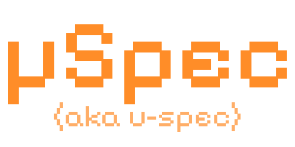

<p align="center">
  
</p>

# u-spec

Four Markdown skills for lightweight spec-driven development. One change
documents the goal, requirement deltas, tasks and verification for one piece of
work. A change can update several specs and is archived as a single file.

## Install

Copy the four folders inside `skills/` into a skill directory supported by your
agent, such as `.agents/skills/`, `.github/skills/` for GitHub Copilot, or
`.claude/skills/` for Claude Code. Keep the folder names unchanged. If your
agent cannot discover skills, ask it to read and follow the relevant
`SKILL.md`. The workflow needs file access and the ability to run project checks.

For an existing v1 project, use [migrate-u-spec-v2](migration/skills/migrate-u-spec-v2/SKILL.md).
Provide the v2 `skills/` folder from a checkout or release bundle and point the
migration skill at the consuming project. The skill checks the original bases,
converts active full-spec changes to deltas, installs the four v2 skills and
updates the provenance README. Consolidated specs and old archives remain
readable as they are. Releases distribute the migration skill separately in
`migration-v<version>.zip`.

## Workflow

| Skill | Outcome |
| --- | --- |
| [propose](skills/propose/SKILL.md) | Investigate the request, clarify consequential choices, and prepare a delta for approval. |
| [change](skills/change/SKILL.md) | Revise the active change, reconcile baseline drift and refresh approval for material revisions. |
| [apply](skills/apply/SKILL.md) | Implement the approved tasks and record passing checks. |
| [archive](skills/archive/SKILL.md) | Apply the delta to its target specs and save one change with verification evidence. |

In a recipe app, `propose add-recipe-collections` can update the recipe library
and add a spec for user-created collections. After approval,
`apply add-recipe-collections` implements and verifies both parts.
`archive add-recipe-collections` updates both specs and saves one record.
An explicit `apply` request can approve the current proposal once its questions
are resolved.

## Files and format

```text
u-spec/
  README.md
  changes/
    add-recipe-collections.md
  specs/
    recipe-library.md
    recipe-collections.md
  archive/
    2026-11-26-add-recipe-collections.md
```

The three directories hold flat Markdown files. A **change ID** names one
piece of work. A **spec ID** names a durable capability and stays stable
across changes. Consolidated specs contain the current title, Scope, Goal,
and Requirements. A spec's scope is `global` or `area:<id>` with a lowercase
kebab-case area ID. Propose, change and apply read global rules and specs for
the affected areas. Archive reads only the named targets.

A v2 change declares `Format: 2` and a status of `draft` (awaiting answers or
approval), `ready`, `applying` or `done`. Archives use `archived`. The active
proposal is the document edited throughout the workflow.

```markdown
# add-recipe-collections: Add recipe collections
Format: 2
Status: ready

## Goal
Let people organize recipes into named collections.

## Targets
- recipe-library: <exact-byte SHA-256 of specs/recipe-library.md>
- recipe-collections: new

## Spec changes

### recipe-library

#### MODIFIED R4
The recipe library links to the collections page.

#### REMOVED R9

### recipe-collections

#### METADATA
Title: Recipe collections
Scope: area:recipes
Goal: Let users organize saved recipes.

#### ADDED R1
Users can create a named collection. A new collection starts empty.

## Tasks
- [ ] T1: Link to collections and remove automatic cuisine groups (recipe-library/R4, recipe-library/R9).
- [ ] T2: Add the named collection form (recipe-collections/R1).

## Verification
- recipe-library/R4, recipe-library/R9: The library links to collections and shows no automatic cuisine groups. | not run
- recipe-collections/R1: Creating `Weeknight dinners` shows that name and an empty recipe list. | not run
```

An operation contains the complete text of its affected requirement. Unchanged
requirements stay in their specs. `REMOVED` has no body. Reference requirement IDs
as `<spec-id>/<requirement-id>`. A new spec needs metadata and one or more
additions. A change can replace existing title, Scope and Goal together with
an explicit metadata block. Use `Approach` when useful and `Questions` for open
decisions. Implementation-only changes can omit both delta sections. An existing
target may appear without operations when its baseline must still be checked.

Keep requirements focused on observable behavior. Put implementation choices
in Approach, test results in Verification, and refer to existing specs or
contracts for shared rules. Add acceptance examples where they clarify a
boundary or an ambiguous behavior. Repository documentation and workflow
files are in English. Conversations can use the user's language.

Archive validates every base before writing, then saves the delta with its
result hashes and applies the exact operations by ID. If interrupted between
spec writes, retry the same archive request. The skill uses the saved hashes
to identify completed writes and stops on unexpected edits. The active file
is removed only after the archive and all results are verified.

The generated `u-spec/README.md` records the repository, author and last-used
framework version on separate rendered lines. The skills update only these
managed fields and preserve unrelated text.

## Compared with OpenSpec

[OpenSpec](https://github.com/Fission-AI/OpenSpec) installs a CLI and organizes
the default change as a folder with separate proposal, design, specs and tasks.
u-spec keeps requirement deltas, tasks and evidence in one Markdown file per
change and runs through four skills without a CLI, configurable schemas or
workflow profiles. That makes u-spec a better fit for a project that wants
fewer files to review and a smaller setup while keeping readable change
history. OpenSpec offers CLI validation and customization. With u-spec, the
agent follows the format and runs the project's checks.

## Releasing

Update all four workflow skill versions with PowerShell before tagging:

```powershell
./scripts/bump-version.ps1 -Version 2.1.0 -WhatIf
./scripts/bump-version.ps1 -Version 2.1.0
```

The script requires four matching version declarations and a higher stable
version. It preserves encoding and line endings. Update the changelog
separately. The release workflow checks the declarations against the tag and
packages the workflow skills and the migration skill as separate ZIP files.
